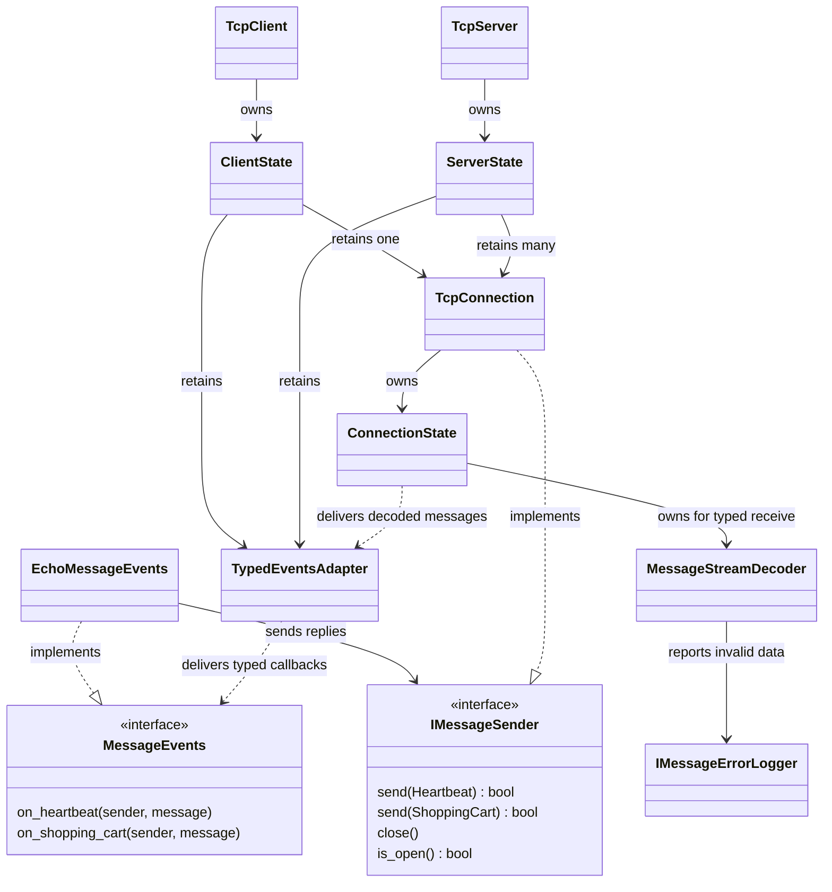

# TCP helper design

The application sends and receives `Heartbeat` and `ShoppingCart` objects through message interfaces. The library connects those interfaces to TCP, handles byte encoding and framing, and checks incoming messages before delivering callbacks.

## How the classes connect



Solid arrows show ownership or use; dashed arrows show interface implementation or callback delivery. `EchoMessageEvents` is the example application handler. The diagram shows the typed API at either end of a connection.

`MessageSenderPtr` is a `std::shared_ptr<IMessageSender>` pointing to a `TcpConnection`. Handlers can retain it to send later. `TcpEvents` is an alias for `MessageEvents`.

## Responsibilities

| Class or interface | Responsibility |
| --- | --- |
| [MessageEvents and IMessageSender](../include/tcp_helper/message_channel.hpp) | Application receive and send interfaces, with no TCP or Boost dependency. |
| [TcpClient](../src/tcp_client.cpp) | Connects to a server. Its private `ClientState` handles resolution, setup, and connection ownership. |
| [TcpServer](../src/tcp_server.cpp) | Listens for clients. Its private `ServerState` accepts and owns active connections. |
| [TcpConnection](../include/tcp_helper/tcp.hpp) | Implements `IMessageSender`. Encodes typed sends and delegates socket work to its `ConnectionState`. |
| [ConnectionState](../src/connection_state.hpp) | Owns the socket and frame buffers. Reassembles frames, enforces limits, and writes queued frames in order. |
| [MessageStreamDecoder](../src/message_stream_decoder.hpp) | Reassembles and validates typed messages, resynchronizing on magic headers after damaged data. |
| [TypedEventsAdapter](../src/typed_events.cpp) | Invokes typed callbacks and converts Boost errors to `std::error_code`. |
| [IMessageErrorLogger](../include/tcp_helper/message_diagnostics.hpp) | Receives structured errors. The file implementation appends and flushes records; tests inject a capturing or mocked logger. |
| [DataBuffer](../include/tcp_helper/data_buffer.hpp) | Owns bytes and a read cursor. Reads/writes fields using Boost.Endian for byte conversion. |

Bootstrap code owns and runs `boost::asio::io_context` and creates the client/server and handler. The [application handler](../examples/echo_message_events.hpp) works through the message interfaces.

## Message objects and encoding

The message types are declared in [messages.hpp](../include/tcp_helper/messages.hpp).

| Type | Contains |
| --- | --- |
| `UserIdentifier` | Login name and a 64-bit user ID. |
| `Heartbeat` | A 64-bit sequence number and one `UserIdentifier`. |
| `ProductItem` | A 64-bit product ID and a `float` price. |
| `ShoppingCart` | One `UserIdentifier` and an ordered `std::list<ProductItem>`. |
| `Header` | Magic number, `MessageType`, and payload byte count. |
| `DecodedMessage` | A `Header`, a `MessageBody` variant holding either message type, and the verified checksum. |

The free functions `encode_message()` and `decode_message()` in [messages.cpp](../src/messages.cpp) translate objects to/from `DataBuffer`. The library calls them automatically for typed sends and callbacks.

## A message travelling between peers

1. The application calls `sender->send(heartbeat)` or `sender->send(cart)`. `TcpConnection` encodes the object, header, and CRC-32 into a `DataBuffer`.
2. `ConnectionState` adds the frame length and reserves queue capacity under a mutex before posting the owned bytes to the TCP thread. Only that thread touches the socket and active write buffers. `send()` returns true when queued, or false when closed or a transport limit is exceeded. Reserved capacity includes posted messages and active writes, and is released on write completion or cancellation.
3. The receiving `ConnectionState` feeds read chunks to `MessageStreamDecoder`, independently of how TCP splits or combines reads.
4. Validated messages reach `TypedEventsAdapter`, which calls `on_heartbeat()` or `on_shopping_cart()`. Invalid data goes to the injected `IMessageErrorLogger`; the connection stays open and the decoder searches for another valid magic/header/CRC/payload candidate.

The bytes on the connection have this layout:

```text
[4-byte frame length][20-byte message header][message payload][4-byte CRC-32]
```

Numeric wire fields use network byte order (big-endian), including float price bits. Buffers keep that ordering; decoded C++ fields hold host values. The CRC covers the message header and payload. The frame length counts all bytes after it.

A corrupt frame length can be recovered using the existing message header. The decoder bounds retained bytes and preserves partial magic between reads. It waits for plausible incomplete frames; when the peer ends the stream, it scans remaining bytes for recoverable complete messages before reporting disconnection. See [logging and recovery details](../README.md#invalid-data-logging-and-resynchronization) for error categories and test injection.

## Ownership and callback lifetime

- Retain the application handler while callbacks are wanted. The adapter holds it weakly, preventing ownership cycles.
- `TcpConnection` owns its state. State references back to the connection, owner, and observer are weak. Pending asynchronous operations retain state and its buffers until completion.
- Callback message references last for that callback; copy messages to keep them.
- Use one `io_context` thread. Sender `send()`/`is_open()`, client `connect()`/`stop()`, and server `stop()` are thread-safe. Connect and stop dispatch transport work internally, executing inline when already on the TCP thread. An off-thread stop returns before cancellation finishes. Server setup remains synchronous and must not overlap other lifecycle calls; sender `close()` uses the TCP thread, or runs before/after it. Callbacks must return promptly and must not throw. Closing can invoke disconnect callbacks immediately.
- Stop clients/servers and drain cancellations during shutdown. Destroy all transport objects and retained senders before destroying the context.

## Raw byte access

`RawTcpEvents` supports custom byte protocols through `TcpConnection` and `DataBuffer` callbacks. It shares the framing and socket implementation; its handler supplies protocol validation. Internally, `TypedEventsAdapter` implements this raw interface to connect TCP to `MessageEvents`.

For a complete exchange in separate processes, see [message_demo_server.cpp](../examples/message_demo_server.cpp) and [message_demo_client.cpp](../examples/message_demo_client.cpp). Both keep the application's `AsioContext`, `TcpDataCollection`, `TcpConnection` snapshot, and `fetch()` polling pattern. Callbacks collect messages under a mutex; the main thread fetches and processes copies. Both peers send periodic Heartbeats, and the client sends a ShoppingCart for the server to echo.

The shared [message_demo_common.hpp](../examples/message_demo_common.hpp) owns the context work guard and background threads. Each demo uses one TCP thread and calls `tcp_.client_->send(message)` directly from its main loop. The sender posts socket work internally; `fetch()` continues to synchronize incoming application data. Setup calls `client_.connect(...)` directly. `TcpSession` calls `transport_.stop()` directly, drains the internally dispatched cancellation work, and joins the thread before the transport or context is destroyed. The server demo tracks one active client snapshot.
